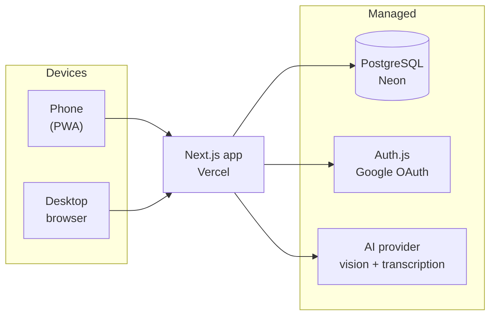
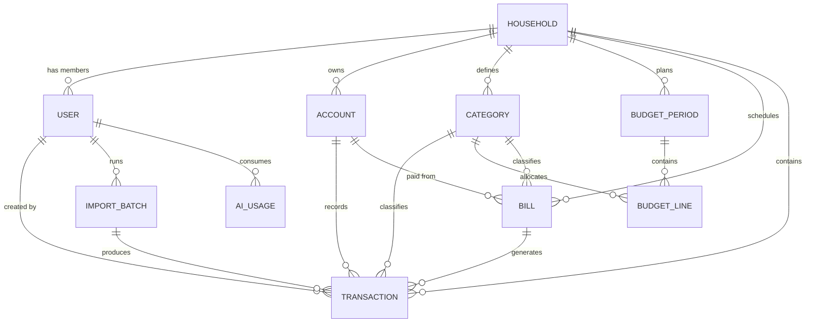
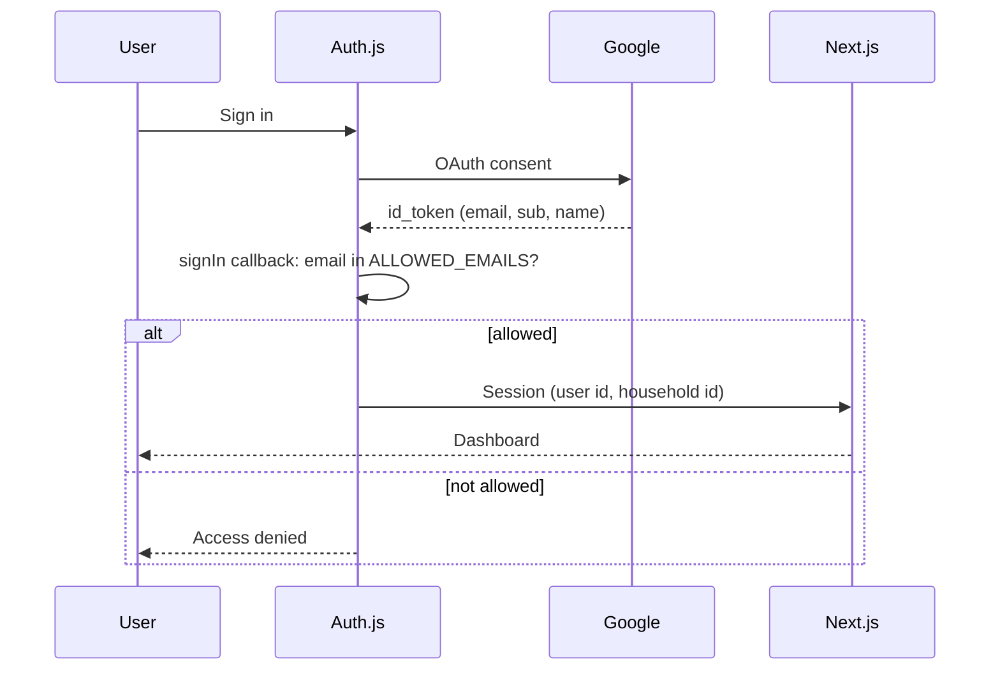
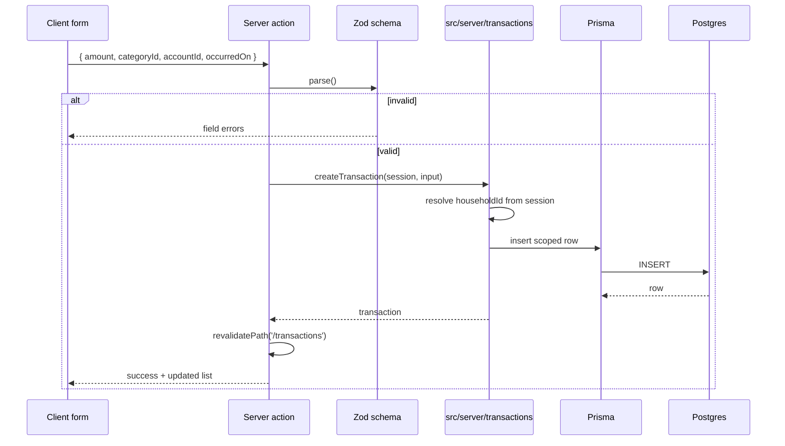

# 03 — Architecture

> Status: draft for review · Last updated: 16 Nov 2026
>
> This document is the reference for **how** we build. Anything technical that is
> decided belongs here, including what we rejected and why (§12).

## 1. Stack and why

| Layer | Choice | What Anthony learns | Why this and not the alternative |
|---|---|---|---|
| Language | **TypeScript**, strict | Types, interfaces, generics, narrowing | Catches whole classes of bug (a dollar amount passed as a string) and is what Melbourne job ads ask for. JavaScript would be faster today and worse in every other way. |
| Framework | **Next.js (App Router)** | React, routing, server vs client components, data fetching | One codebase gives UI, server logic and an API. A separate Express API would teach the same concepts with twice the wiring and half the polish. |
| UI | **React 19** | Components, state, props, hooks, forms | The default front-end skill in job ads. |
| Styling | **Tailwind CSS + shadcn/ui** | Utility classes, accessible components, design tokens | Fast, consistent, and shadcn gives accessible primitives rather than hand-rolled modals. |
| Database | **PostgreSQL** | Relational modelling, SQL, indexes, aggregates, transactions | Relational data is the whole app. A document store would hide the modelling lessons and make budget aggregates harder. |
| ORM | **Prisma** | Schema-as-code, migrations, relations, typed queries | The migration workflow is explicit and readable, which is what a learner needs. Drizzle is leaner but assumes more SQL fluency. |
| Auth | **Auth.js** with Google | OAuth, sessions, middleware, callbacks | Google sign-in means no password handling, no reset flows, no hashing mistakes. |
| Validation | **Zod** | Schema validation, inference, parsing untrusted input | One schema validates the form and the server. |
| Tests | **Vitest** + **Playwright (light)** | Unit tests for logic, one or two end-to-end flows | Full coverage is not the goal; money and dates are. |
| Hosting | **Vercel** (app) + **Neon** (Postgres) | Deployments, preview builds, environment variables, CI | Free tier covers a two-person app; preview deploys per branch are a real professional workflow. |
| Package manager | **pnpm** | Lockfiles, workspaces | Faster, stricter than npm. |

Deployment reality check: Vercel + Neon free tiers comfortably handle two users.
The only real cost is a domain name (~$15/year) and optionally a few cents of AI
usage.

## 2. System shape



There is no separate backend service. Server components and server actions run
on the server inside the same Next.js deployment. That is a deliberate
simplification: fewer moving parts to learn, and the same concepts.

## 3. Data model

### Entity relationships (Phase 1)



### Tables

**Household** — `id`, `name`, `createdAt`, `savingsTargetCents` (nullable),
`savingsTargetOn` (nullable date). Exactly one row in v1; the model exists so
nothing is hard-coded to "the household". The target is configuration, not a
goals table (D26).

**User** — `id`, `householdId`, `email` (unique), `name`, `image`, `role`
(`member` | `demo`), `createdAt`. `role: demo` is read-only and seeded.

**Account** — `id`, `householdId`, `name`, `type` (`transaction` | `savings` |
`cash` | `credit`), `openingBalanceCents`, `currency` (default `AUD`), `colour`,
`archivedAt`, `sortOrder`.

**Category** — `id`, `householdId`, `name`, `kind` (`income` | `expense`),
`parentId` (one level only), `icon`, `colour`, `archivedAt`, `sortOrder`.

**Transaction** — `id`, `householdId`, `accountId`, `categoryId`, `amountCents`
(**signed**: negative = money out), `occurredOn` (date), `description`,
`merchant`, `note`, `status` (`needs_review` | `confirmed`), `source` (`manual` |
`import` | `ai` | `bill`), `transferGroupId` (nullable, links the two sides of a
transfer), `importBatchId`, `billId` (nullable, the bill a payment settles —
D25), `fingerprint` (nullable, unique per household, for idempotent imports),
`createdById`, `createdAt`, `updatedAt`.

> Note: the model is `Transaction`; Prisma's interactive transactions are
> `prisma.$transaction()`. Different things, similar names. Expect this once.

**BudgetPeriod** — `id`, `householdId`, `label`, `startsOn` (date), `endsOn`
(date), `unique(householdId, startsOn)`, `notes`. v1 writes one per calendar
month (D23); the explicit range keeps the period length a configuration detail
rather than a schema change. Allocation is triggered by an income event, not by
a second period.

**BudgetLine** — `id`, `budgetPeriodId`, `categoryId`, `allocatedCents`.
`unique(budgetPeriodId, categoryId)`.

**Bill** — `id`, `householdId`, `name`, `amountCents` (positive), `frequency`
(`weekly` | `fortnightly` | `monthly` | `quarterly` | `yearly`), `nextDueOn`
(date), `categoryId`, `accountId`, `autoCreateTransaction` (bool), `archivedAt`.

**ImportBatch** — `id`, `householdId`, `createdById`, `source` (`csv`),
`fileName`, `rowCount`, `importedCount`, `skippedCount`, `createdAt`.
Transactions carry a `fingerprint` (unique per household) made from date, amount
and normalised description, which is what makes imports idempotent.

**AiUsage** — `id`, `householdId`, `userId`, `model`, `inputTokens`,
`outputTokens`, `estimatedCostCents`, `feature`, `createdAt`. Written on every AI
call so the cap in AI-4 is enforceable and auditable.

Later phases add: `Event`, `Chore`, `ChoreCompletion`, `Recipe`, `Ingredient`,
`MealPlanEntry`, `GroceryItem`, `WorkoutTemplate`, `WorkoutLog`.

## 4. Conventions that prevent real bugs

These are not style preferences. Each one prevents a bug class that would
otherwise ship.

1. **Money is integer cents, everywhere.** `$12.35` is `1235`. No floats, no
   `Decimal` arithmetic in application code. Format only at the edge with
   `Intl.NumberFormat('en-AU', { style: 'currency', currency: 'AUD' })`.
   *Why:* `0.1 + 0.2 !== 0.3` in floating point, and a budget that drifts by a
   cent per transaction is a budget nobody trusts.
2. **Signed amounts.** Expenses negative, income positive, one `SUM` gives the
   net. Display code uses the absolute value. Transfers are two rows joined by
   `transferGroupId` and excluded from income/expense totals.
3. **Dates vs timestamps.** A transaction date or bill due date is a calendar day:
   store as `@db.Date`, and cross the app boundary as an ISO string
   (`"2026-11-16"`). All calendar arithmetic goes through `src/lib/dates.ts`, which
   works on whole days and never turns one into an instant. An event or a session
   is a moment: `timestamptz`, stored in UTC, rendered in
   `Australia/Melbourne`. Mixing these causes "yesterday's coffee appears
   tomorrow" bugs.
4. **Every query is household-scoped.** Reads and writes go through
   `src/server/*` functions that take the session and derive `householdId`
   themselves. Route handlers never accept a `householdId` from the client.
5. **Validate at the boundary, trust inside.** A Zod schema parses every server
   action input. After that, types are trusted.
6. **Derived data is computed, not stored.** Budget actuals, account balances and
   dashboard totals are SQL aggregates. Storing them means they will eventually
   be wrong.
7. **Stable IDs.** `cuid2` or `uuid`, generated by the database or the ORM, never
   sequential integers exposed in URLs.
8. **Soft delete for referenced rows.** Categories and accounts archive; only
   transactions and imports actually delete (with an undo window).

## 5. Authentication and access



- **Provider:** Google only. No passwords stored, ever.
- **Allowlist:** `ALLOWED_EMAILS` is a comma-separated environment variable.
  Enforced in the `signIn` callback, server-side. The UI never decides access.
- **Session:** JWT cookie, `httpOnly`, `secure`, `sameSite=lax`, 30-day rolling.
- **Household:** resolved from the session on every request. No client-supplied
  household identifiers are ever trusted. Until provisioning lands, the session
  carries the Google identity only; the `User` row and its `householdId` are
  added on first sign-in in the next step.
- **Demo mode:** a seeded `role: demo` user can read but not write; mutations
  check the role server-side. This is what the public deployment shows.

## 6. Folder structure

```
life-organiser/
├─ docs/
├─ prisma/
│  ├─ schema.prisma
│  ├─ migrations/
│  └─ seed.ts                # fictional household
├─ public/
├─ src/
│  ├─ app/
│  │  ├─ (auth)/login/page.tsx
│  │  ├─ (app)/
│  │  │  ├─ layout.tsx        # shell: sidebar + mobile tabs
│  │  │  ├─ dashboard/page.tsx
│  │  │  ├─ accounts/page.tsx
│  │  │  ├─ transactions/
│  │  │  │  ├─ page.tsx
│  │  │  │  └─ [id]/page.tsx
│  │  │  ├─ budgets/page.tsx
│  │  │  ├─ bills/page.tsx
│  │  │  ├─ reports/page.tsx
│  │  │  └─ settings/page.tsx
│  │  ├─ api/
│  │  │  ├─ auth/[...nextauth]/route.ts
│  │  │  ├─ import/csv/route.ts
│  │  │  └─ ai/capture/route.ts
│  │  ├─ layout.tsx
│  │  └─ globals.css
│  ├─ actions/                # server actions, one file per area
│  │  ├─ transactions.ts
│  │  └─ budgets.ts
│  ├─ components/
│  │  ├─ ui/                  # shadcn primitives
│  │  └─ transactions/        # feature components
│  ├─ lib/
│  │  ├─ db.ts                # Prisma client singleton
│  │  ├─ auth.ts              # Auth.js config
│  │  ├─ money.ts             # cents <-> display
│  │  ├─ dates.ts             # month bounds, AU timezone helpers
│  │  └─ validation/          # Zod schemas
│  ├─ server/                 # data access + business logic
│  │  ├─ transactions.ts
│  │  ├─ budgets.ts
│  │  ├─ bills.ts
│  │  ├─ import.ts
│  │  └─ ai.ts
│  └─ types/
├─ tests/
├─ .env.example
├─ AGENTS.md
└─ README.md
```

Rule of thumb: **`app/` decides what to show, `server/` decides what is true.**

## 7. Request flow, end to end

Adding a transaction, as an example of the pattern every feature follows:



## 8. Integrations

### 8.1 CSV import

- **Flow:** user picks a `.csv` on their device → the browser sends it to a server
  action → the server parses it → column mapping → preview → rows land as
  `needs_review` → user confirms.
- **Nothing is stored but the result.** The upload is held in memory for the
  request and discarded. Only `Transaction` rows and an `ImportBatch` summary
  survive. No blob storage, no token storage, no copy of a real bank export.
- **Size limit and validation:** reject anything over ~5 MB or with an unexpected
  content type before parsing. Parse defensively; every row is untrusted input.
- **Parser:** hand-written for learning, and tested hard — quoted fields, embedded
  commas and newlines, CRLF, a header row, and empty trailing rows are the cases
  that break naive `split(',')`.
- **Sheets:** a Google Sheets export is downloaded as CSV by the user; there is no
  Sheets API call in v1.
- **Idempotency:** a `fingerprint` unique index per household
  (`sha256(date|amountCents|normalisedDescription)`) makes a repeated import a
  no-op instead of a duplicate.

> Google Drive (OAuth picker, encrypted refresh tokens, `drive.file` scope) is
> parked as FIN-11 in `02-features.md` §8. The notes formerly here are kept in git
> history and can be restored if that decision is reversed.

### 8.2 AI capture

Deliberately provider-agnostic. A thin interface (`src/server/ai.ts`) exposes:

```ts
type CaptureInput =
  | { kind: 'text'; text: string }
  | { kind: 'image'; bytes: Uint8Array; mimeType: string }
  | { kind: 'audio'; bytes: Uint8Array; mimeType: string };

type CaptureResult = {
  amountCents: number | null;
  merchant: string | null;
  occurredOn: string | null;
  suggestedCategoryId: string | null;
  confidence: 'low' | 'medium' | 'high';
};
```

- Structured output is enforced with a JSON schema, then parsed with Zod. Never
  parse prose with regex.
- Audio is transcribed first (`gpt-4o-mini-transcribe` or Gemini transcribe),
  then the transcript goes through the same text path.
- **Cost control:** estimate cost after each call, write to `AiUsage`, and refuse
  the request when the month's total exceeds `AI_MONTHLY_BUDGET_CENTS`.

**Cost model at current published rates (USD)**

| Operation | Model tier | Unit cost | Per capture |
|---|---|---|---|
| Text → fields | small model, $0.25/1M in, $2.00/1M out | ~250 in, ~150 out tokens | ~$0.0004 |
| Photo → fields | same, ~1.5k image tokens | ~1.7k in, ~150 out | ~$0.0007 |
| Voice 20s | transcription $0.003/min | 0.33 min + extraction | ~$0.0015 |

Realistic usage of 8 captures/day for two people is ~240/month → **~$0.25 USD,
under $1 AUD including retries.** A $5 AUD monthly cap is generous and still
trivial.

## 9. Security and privacy

- Secrets live in Vercel environment variables and `.env.local`. `.env.example`
  documents names only.
- All mutations are server actions or route handlers; the client never talks to
  the database directly.
- Rate limit the AI and import endpoints per user (in-memory is fine for two
  users; note the limitation).
- Prisma parameterises queries; no raw SQL string interpolation.
- Cookies are `httpOnly`; no tokens in `localStorage`.
- CSP and `Referrer-Policy` headers set in `next.config.ts`.
- No third-party analytics on authenticated routes.
- Every response that could leak another household's data is covered by a test.

## 10. Testing strategy

| Level | Tool | What is tested |
|---|---|---|
| Unit | Vitest | Money parsing/formatting, month boundaries, fingerprinting, budget maths, Zod schemas |
| Component | Vitest + Testing Library | Transaction form validation, budget bar states |
| End-to-end | Playwright | Sign in → add transaction → appears on dashboard → budget updates |
| Manual | A phone and a desktop | Every milestone ends with both |

Target: the logic that would quietly produce wrong money is tested. Not 100%
coverage.

## 11. Environments

| Environment | App | Database | Data |
|---|---|---|---|
| Local | `pnpm dev` | Neon project `life-organiser`, branch **`dev`**, direct connection | A copy of `production` taken when the branch was created; disposable |
| Preview | Vercel preview per branch | No preview branch yet — a preview deploy needs a branch of its own before it can be used | — |
| Production | Vercel | Neon project `life-organiser`, branch **`production`**, pooled connection | Real household, writes enabled |

Local and production are **branches of one Neon project**, not separate
projects (D20). A branch is copy-on-write: it starts as the parent's data, and
storage only grows with what differs. Production is deployed at
`https://life-organiser-eight.vercel.app` and auto-deploys from `main`; its
environment variables exist for Production only (D22).

Migrations: `prisma migrate dev` locally. Production migrations are applied by
hand against the `production` branch, with `prisma migrate deploy`, before the
deploy that needs them — there is no CI yet. Never edit a migration that has
been applied.

## 12. Decision log

Rows carry an ID (`D1`, `D2`, …) that other documents cite — `docs/00-status.md`
keeps the settled list. **Do not renumber**: append new rows at the end, even
when a row reverses an earlier one. Two rows record a reversal: D10 reverses D7.

| ID | Date | Decision | Why | Alternatives rejected |
|---|---|---|---|---|
| D1 | 2026-11-15 | Single Next.js app, no separate API | Fewer moving parts while learning; same concepts | Express + React SPA; tRPC monorepo |
| D2 | 2026-11-15 | TypeScript strict | Type safety is the point of choosing TS | Plain JavaScript |
| D3 | 2026-11-15 | PostgreSQL + Prisma | Relational data, readable migrations | SQLite; MongoDB; Drizzle |
| D4 | 2026-11-15 | Money as signed integer cents | Removes float rounding bugs | `Float`; `Decimal` in app code |
| D5 | 2026-11-15 | Google sign-in, two-email allowlist — **extended by D29** | No password handling; closed by default | Email magic links; passwords |
| D6 | 2026-11-15 | Finances built first | User priority; hardest data modelling, best learning | Meals + groceries vertical slice |
| D7 | 2026-11-15 | **Superseded by D10.** Drive via Picker + `drive.file` scope | Least privilege, simplest consent | `drive.readonly` |
| D8 | 2026-11-15 | AI capture deferred to Phase 4 | Data model must settle first; not on the critical path | Build AI first |
| D9 | 2026-11-15 | App name: Life Organiser | Chosen by owner | Hearth, Kin, Nest |
| D10 | 2026-11-16 | **Reverses D7.** CSV upload replaces Drive in v1 | Same outcome without OAuth, token storage or refresh-token expiry; keeps the riskiest week tractable | Keep Drive; store uploads in blob storage |
| D11 | 2026-11-16 | Component caching off (`cacheComponents`, `partialPrefetching`) | Fresh data while learning; stale data mimics a bug | Leave defaults on; learn caching deliberately later |
| D12 | 2026-11-16 | `@types/node` tracks the runtime (^26) | The compiler should describe the machine it runs on | Leave at ^20 |
| D13 | 2026-11-16 | Calendar days are ISO strings, arithmetic in `src/lib/dates.ts` | A day has no time or timezone; strings make the month-boundary bug impossible and tests readable | `Date` at UTC midnight; a wrapper class |
| D14 | 2026-11-19 | Neon for the dev database as well as production; the CLI uses the **direct** connection | One provider, so local and deployed behave the same. Migrations cannot run through a pooled connection, so pooling is a deploy-time concern | Docker Postgres locally; deferred to a session of its own |
| D15 | 2026-11-20 | `next-auth` pinned to **`5.0.0-beta.32`**, exactly | v5 is the line built for the App Router and React 19. An exact pin means a new beta cannot change behaviour under us mid-week | v4 (no App Router integration); hand-rolled signed-cookie sessions |
| D16 | 2026-11-20 | **JWT sessions, `User` row created on first sign-in.** No Prisma adapter, so no `Account` or `Session` tables | Two tables instead of four, and nothing about our data takes Google's shape. Refresh tokens are not needed for sign-in only | Prisma adapter (conventional, adds two tables and a dependency) |
| D17 | 2026-11-20 | The single v1 `Household` row is **inserted by hand once**; the app resolves the one that exists | Cheapest option while there is exactly one household. The seed script arrives with the demo household, not before | Seed script now; create-on-first-sign-in |
| D18 | 2026-11-21 | **`@prisma/adapter-pg@7.10.1` + `pg`** as the Prisma driver adapter | Ordinary Postgres semantics, so dev and production behave identically, and it uses the direct connection string already in `.env.local`. Pooling stays Neon's job at deploy time | `@prisma/adapter-neon` (expects the pooled host, so dev and prod would differ); deferring again (blocks Week 1's acceptance test) |
| D19 | 2026-11-23 | **Plain Tailwind for the app shell**; shadcn/ui is not introduced in Week 1 | The shell is a sidebar, bottom tabs and a placeholder — roughly forty lines. shadcn/ui is worth its dependency when the first component actually needs a dialog or a toast | shadcn/ui now (costs the session and delays the deploy); deferring the shell entirely (Week 1 ends with nothing on screen) |
| D20 | 2026-11-23 | **A separate Neon branch, `dev`, holds local data; `production` is for the deployed app** | `prisma migrate dev` can reset a database when it detects drift, and local experiments plus the two-person test must not touch the household's real rows. A branch is copy-on-write, so the storage cost is negligible | One branch for both (cheapest, but a bad migration destroys real data); a second Neon project (the console, the limits and the billing counted twice) |
| D21 | 2026-11-23 | **Dark mode follows the operating system**; there is no in-app toggle | XC-3 asks for dark mode, not for a control. Swapping tokens under `prefers-color-scheme` means no stored preference, no second client island and no flash of the wrong theme — and every component names a role (canvas, surface, ink, line, accent) instead of a colour | A visible toggle (an explicit override, paid for with a cookie read to avoid the flash); automatic plus override (most flexible, most work) |
| D22 | 2026-11-23 | **Vercel environment variables are set for Production only**; a preview deployment has no database and would fail at build | There is no preview branch, and a preview pointed at `production` would write the household's real rows from throwaway builds. A preview that fails loudly is the safer failure | Let previews share `production` (cheapest, but throwaway builds touch real data); create a preview branch now (extra setup before Week 2) |
| D23 | 2026-11-24 | **Monthly budget periods, with allocation triggered by each income event** | The month is the reporting frame (FIN-4/FIN-5/FIN-7); the deposit is the action frame. A fixed fortnight would misalign the wife's irregular income. The two-tier idea survives as an event, not a second period | Fortnightly periods (matches the pay cycle, but splits monthly bills unevenly and creates 26 periods); monthly plus fixed fortnightly sub-periods (extra rows, same misalignment) |
| D24 | 2026-11-24 | **FIN-12 income allocation is P1 Phase 1; AI capture is cut from the 16-week plan** | The owner's stated use is allocating each deposit across accounts; AI capture is P2/Phase 4 (FIN-9, D8) and can wait | Keep AI (needs the week FIN-12 needs); park FIN-12 (the finance side would not do the job it is built for) |
| D25 | 2026-11-24 | **`Transaction.billId` links a payment to the bill it settles** | "Which bills did we pay" must be a query, not an inference from amount and date, which breaks on similar amounts and part payments | A `BillPayment` table (more correct for part payments, but a table the v1 UI does not need); no link (cheap now, expensive once real data exists) |
| D26 | 2026-11-24 | **One household savings target (amount + date), no goals module** | The brief says the goal is configuration; a target is enough for the allocation plan and the dashboard, and a goals module is backlog | A `Goal` table and progress UI (scope without a v1 use); no target (the allocation plan has nothing to allocate to) |
| D27 | 2026-11-25 | **Deleting a transaction is a soft delete** (`deletedAt`); the 10-second undo clears the column | The undo has to survive a reload or a closed tab, which a browser-side delayed delete cannot, and it gives CSV import a reversible operation for free. The cost is one filter every read must apply, so it exists once, in `liveTransactionWhere` | Client-side delayed delete (no schema change, but the delete is lost on navigation); hard delete plus a separate audit table (more machinery than a two-person household needs) |
| D28 | 2026-11-25 | **shadcn/ui's dialog and Sonner toast are introduced**, copied into `src/components/ui` and mapped onto the project's role tokens | This is the first UI that genuinely needs a focus-trapped dialog and a toast, which D19 anticipated. Hand-rolling the portal, focus trap and escape handling is where accessibility bugs come from. The CLI `init` was deliberately not used: it rewrites `globals.css` and assumes `--accent` means a hover surface, which is this project's strong action colour | Hand-rolled Tailwind dialog and toast; Radix primitives without the shadcn wrapper; deferring again and using a browser `confirm` |
| D29 | 2026-11-25 | **The allowlist admits a third address: Anthony's software-development mentor, who reviews the work.** Extends D5 | Anthony wants the work reviewed by someone outside the household, and the allowlist is the only door in. The account is a normal `member` with the same access as the household, which Anthony confirmed is intended; read-only review access is not built | A read-only review role (more correct eventually, but there is no role enforcement to hang it on yet); sharing Anthony's account (no separation, and his session would change hands); no third access |
| D30 | 2026-11-25 | **Cassidy's business account is an ordinary tracked account; its inflows are household income** | Her accounting software handles GST and tax before money reaches the account, so nothing has to be excluded and no draw adjustment is needed. One ledger, one set of rules, and her income is measured like Anthony's | A balance-only account excluded from reports (needs a flag plus a "the transfer counts as income" exception, which is easy to get wrong); keeping the business out of the app (loses both the balance and her income) |

## 13. Open technical questions

1. Does the bank export a single CSV or one per account? Affects the import
   mapping UI.
2. Push notifications: Web Push via service worker, or email only? Deferred, but
   the PWA decision affects it.
3. Realtime between two devices (grocery list, Phase 3): polling, Supabase
   Realtime, or server-sent events? Decide when that phase starts.
4. Inter-account transfers appear in two bank CSVs — an outflow in one and an
   inflow in the other. The import must pair them (same magnitude, opposite
   sign, dates within a day or two, different accounts) or the monthly totals
   count the same money twice. **Investigated 25 Nov 2026** — see
   `docs/reference/csv-import-findings.md`. Real exports show that amount and
   date alone produce false positives (11 candidates, several implausible; only
   1 of 10 joint transfers matched even with three other accounts present), that
   narrative tokens name the counterparty and do not cross-match between files,
   and that some transfers (rainy-day credits) carry no keyword at all.
   **Recommendation (proposed, not agreed):** record each account's own bank
   reference, suggest candidates from keyword + reference + equal cents + date
   window, require human confirmation, allow one-sided transfers, and exclude
   only balanced groups from totals. Decide with Anthony before FIN-8.
5. **No unique transaction id from the bank.** The `Serial` column in the data
   export is empty, and the app export has no such column, so the current
   date + amount + description fingerprint would drop a legitimate second
   identical purchase. The dedupe rule has to become a multiset difference
   against existing rows (insert only the excess), which also handles overlapping
   export windows. Proposed, not built.
6. **Which file format should the importer target?** CSV works but carries no
   transaction type or unique id. OFX/QBO would provide both (`TRNTYPE`,
   `FITID`); QIF marks transfers by category convention; PDF has neither and is
   the most brittle. Compare formats before writing FIN-8.
